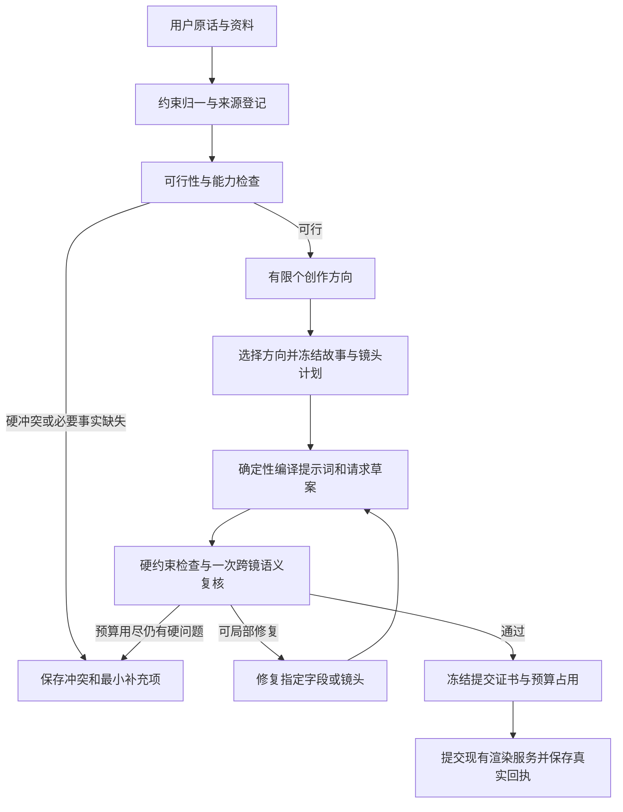

# Growthtest 视频前期创作架构对齐方案

本方案覆盖通用与营销视频从用户意图到付费渲染提交前的创作过程，面向产品所有者、视频创作者与维护团队。**建议把创作过程改为“先确定可行空间，在空间内创作，再验证最终提交包”**。严格约束继续存在，但应有明确来源、作用范围、负责检查的位置和修复对象。

状态：待产品方向对齐，未实施。此次审计中的实现缺陷修复另见审计报告，不代表已采纳本方案。文中 A 为实际源码精读；B 为机械统计或运行结果；D 为设计建议、假设或尚未验证的效果。方案里的结构、接口与目标值均为 D 级提议。

## 覆盖率声明

- 本方案沿用同轮代码审计范围：233 个文件；精读117、机检/引用解析113、抽样3、完全未检查0。机检仅是元数据和引用解析，不代表逐行理解。
- 逐项未精读原因与抽读区段见配套审计报告的 `coverage.csv`、`coverage.json`；vendor大型内部模块与跨阶段大文件的裁剪不能由测试通过替代。
- 方案没有新增源码实施或真实付费实验；关于收益和拟定接口的内容均标为D级。

## 现状与问题根源

【A】真实 Studio 主链仍由 `apps/server/src/video/studio-worker.ts`、`packages/video-studio/src/studio.ts` 和 vendor 执行器推进。`docs/PIPELINE-CONTROL-PLANE.md` 明确新控制面处于影子模式；它记录阶段、产物和门裁决，但没有接管旧执行器的修复与恢复。不能因为控制面已有 `GateFinding`、`itemKey` 和 `nextAction`，就认为创作执行已经按字段或镜头拆开。

【A】服务端 G1–G7 之间仍存在独立内容生成、门确认、监制审核与最终资格核验。`studio-worker.ts` 的 `runOnce` 包住整段预生产；`VM_PRODUCER_RETRY` 默认关闭，显式开启时也是重跑这段。`producer-gate.ts` 对监制结果要求 `approved` 与分数阈值同时成立，模型故障则返回未验证。这有助于防止不合格内容付费，但未给执行器提供稳定的局部纠错路线。

【A】约束分散在用户原话、metadata、Brief、PRD、镜头字段、完整提示词、监制 rubric、营销事实证据和最终请求之间。同一维度可能被多个位置重新解释。此次已复现的画幅冲突、禁配乐误禁人声、样例动作覆盖源人物道具，正是这些转换发生语义漂移的具体实例。

【A】`gate-policy.ts` 的 G6 rubric 包含每镜至少 1200 字与 25/30 字段要求。它是现行门口径，不能在这次修复中擅自删除。但“形式齐全”与“创作精彩”是不同判断；将二者混成一个失败条件，会促使模型扩写和重复表达，增加自相矛盾的机会。【D】它对实际延迟、成功率和视频质量的净影响，仍需真实样本对照测量。

【A】一句话导演还有独立 `director-planner.ts → director-worker.ts → Studio` 路径。导演方案已有镜头、动作和声音，但进入 Studio 时会把冻结方案再次序列化为意图文本。建议未来通过正式结构化适配器传递冻结镜头，减少再次命题和再次解释。当前不实施这条执行切换。

【A】营销宿主在三站都有可用正文的路径中，G1 前会串行做三次事实提取和三次来源支持审核；最终再按 N 个镜头逐个审核事实。辅助站没有正文时会记录空事实与用途限制，不发生那两次模型调用，因此不能把“6+N”当作所有项目的固定次数。精确调用预算应按真实分支记录。

【A】`production-client.ts` 与 `production-authority.ts` 的正式 N 镜提交路径还有重复的完整前期源包检查：开始读取一次，每镜资格签发前后、客户端确认与提交授权分别复读。对该正常路径静态计数为 `4N+1` 次完整源检查；营销检查每次又遍历全镜，存在随 N 平方增长的本地遍历成分。该结论是源码结构推导，不是生产耗时测试。建议最终前期证书绑定完整来源摘要与检查版本，未变的完整包检查可复用，逐镜仍核验最终 prompt、参数、资产和资格字节。

## 用户与可验证场景

| 场景 | 用户必须保留的条件 | 系统应该怎样工作 | 用户不用这一能力会怎样 |
|---|---|---|---|
| 通用叙事片 | 横版、指定角色、五个动作按顺序、无配乐但保留一句对白 | 先核对动作与台词能否装进时长；在该范围内选择机位和光线；最终画幅与声音字段一致 | 在后期才发现竖构图、人物被替换或对白被静音 |
| 商品营销片 | 指定商品、授权模特、30 秒目标、不得编优惠或功效 | 先生成可使用与不可使用主张清单；围绕真实卖点创作多个角度；只局部修复未被来源支持的句子 | 为了通过审核反复搜资料、反复改整片，或付费后才发现违规主张 |
| 已有前期的局部修改 | 只把 CTA 从“立即购买”改成“了解详情” | 只使 CTA、相关镜头提示词与相应语义审核失效；保留商品事实和未受影响镜头 | 小改触发整段重新生成，成本和结果都不可预测 |
| 无法同时满足的要求 | 5 秒内完整说完一段很长台词且不能改词 | 在创作前给出可计算的冲突与可行替代，保留完整台词，不生成“已通过”的假计划 | 长时间迭代后仍无产出，或用截断和变速掩盖冲突 |

## 两个候选方案与选择

| 方案 | 实现方式 | 优点 | 成本与风险 | 适用前提 |
|---|---|---|---|---|
| A 在现有串行管线补局部修复 | 保留全部生成阶段与审核门；把拒绝原因结构化，回到指定阶段重做 | 改造较集中，可逐门迁移，容易回滚 | 多份事实源与重复语义审核仍在；局部修复后可能被后续重新解释 | 短期只想减少重跑，且暂不接受创作表示层调整 |
| B 统一约束与创作表示，再编译提示词 | 冻结 ConstraintSet、EvidenceBundle、StoryPlan、ShotPlan；模型负责创作选择，程序负责规格传播；提交包只由编译器生成 | 一条硬约束有明确检查点；可追踪冲突；支持候选比较和按依赖修复 | 需要适配旧 vendor、迁移测试与灰度；不能一次全换执行器 | 接受分阶段建设，继续保留原有付费边界 |

**建议选 B，先用 A 的局部修复能力做过渡。**【D】原因是现在的痛点同时来自执行粒度和多次语义转写；只加重试策略无法解决后者。暂不引入新的 Agent 框架、向量库或外部编排服务，先复用本仓已有控制面、产物表、门裁决与租约。

## 约束如何表达

所有约束进入同一个有版本的集合，每项至少有：`constraintId`、`dimension`、`scope`、`value`、`origin`、`sourceRef`、`priority`、`verification`、`owner`。`scope` 可以是全片、某镜头、某人物、某商品或某段台词。

| 类别 | 例子 | 裁决方式 | 可否被模型自行放宽 |
|---|---|---|---|
| 资格与成本硬条件 | 真实授权、商品来源、预算、请求完整性 | 确定性验证；不成立禁止提交 | 不可 |
| 用户明确创作硬要求 | 指定人物、不得说某句、动作顺序、声音来源、合同硬时长 | 能程序化的确定性检查；自然语言部分由有证据引用的语义检查 | 不可；冲突必须显式解决 |
| 系统推导的实现条件 | 当前模型逐镜时长范围、画幅枚举、参考图数量 | 从模型能力合同编译到镜头计划 | 不可伪装成用户要求；可换有授权的实现方式 |
| 创作偏好 | 高级感、温暖、节奏紧凑、好看 | 排序与比较，保存依据与用户反馈 | 可在不违反硬要求时权衡 |

【D】“不出现未经支持的功效主张”是硬要求；“前三秒更吸引人”是优化目标。二者不能都变成无限追求 100 分的门。用户明确指定的创作偏好，也可提升为硬要求，来源与优先级必须保留。

前置可行性检查输出 `feasible`、`conflicts`、`unknownRequiredInputs`、`allowedChoices`。它不调用媒体模型。未知授权与未知预算继续阻断；缺审美评分不能被解释成违反授权。

## 推荐的完整流程

【D】创作方向建议先支持 1–3 个，按任务复杂度和文字预算选，默认不并发完整生成三套长提示词。候选只包含切入点、叙事结构、视觉母题、营销理由与风险；方向确定后才展开镜头。候选数量是可测策略，不是固定模板。

营销片在 B–C 之间构建 EvidenceBundle：保留请求 URL、最终 URL、正文摘要、抓取时间、逐主张引用位置和用途限制。用户自己提供的营销描述不自动成为已核实事实。当前营销宿主已支持 A2/A3 无证据时保留空事实与明确用途限制，基于有效 A1 继续制作。新架构建议沿用该策略；若要调整允许继续的条件，再作产品方向对齐。

StoryPlan 负责叙事因果、顺序和全片卖点；ShotPlan 负责每镜目的、可见动作、台词、时长、人物/商品资产、光线与声音。各镜不再重复定义商品价格、人物身份或全局画幅，只引用冻结事实。

提示词编译器把结构化计划序列化为当前供应商所需文本。字段顺序、必填项、画幅、时长、语言、禁止项与资产绑定由程序写入。模型可以提出新创意，但不能在编译环节偷偷替换已冻结事实。

## 数据与已有系统的衔接

【D】优先用现有 `video_artifacts` 保存不可变 JSON；用 `production_stage_runs` 的 `node_key / item_key / attempt` 定位镜头；用 `video_stage_edges` 表达依赖；用 `video_gate_decisions` 的 findings 记录问题。第一阶段不新增业务表。

| 产物 role 与拟定 schema | 核心字段 | 内容摘要参与什么 |
|---|---|---|
| `constraints` / `workloom.video-constraints/v1` | 原话引用、约束项、优先级、scope、来源、冲突 | 所有下游输入散列 |
| `evidence` / `workloom.video-evidence/v1` | 来源、主张、引用位置、授权与用途范围 | 营销语句与资产资格 |
| `story_plan` / `workloom.video-story/v1` | 方向、因果、顺序、目标受众、CTA、承诺边界 | 镜头计划和全片审核 |
| `shot_plan` / `workloom.video-shot/v1` | 镜号、目的、动作、台词、时间窗、人物/商品引用 | 单镜编译和局部修复 |
| `render_package` / `workloom.video-render-package/v1` | 编译器版本、逐镜最终 prompt、供应商参数、引用资产、检查结果 | 最终资格 token 与实际提交 |

【D】既有 `pipeline_run_id / stage_run_id / role / facts_snapshot_hash` 做查询与作用域基础；实现前检查现有索引是否覆盖查询，只有执行计划证明确有需要时才提新增索引。不能为了方案好看，先增一套重复数据库。

旧 vendor 通过适配器消费 `StoryPlan / ShotPlan`。一期先双写并离线比较旧、新产物；不会让两个执行器同时提交渲染。只有逐字段契约通过后，才逐节点把真实执行权切换到控制面。

## 建议的接口合同

下表均为拟议的服务内部接口，不是当前已存在能力。对外工具名称要等实现后同步正式能力 schema。

| 接口 | 输入 | 返回 | 主要错误 |
|---|---|---|---|
| `POST /video/preproduction/plan` | `rawIntent, assetRefs, deliveryOptions, idempotencyKey, maxTextBudget` | `projectId, revision, constraintHash, status, conflicts, candidates` | `INPUT_CONFLICT`, `REQUIRED_FACT_MISSING`, `TEXT_BUDGET_EXHAUSTED` |
| `POST /video/preproduction/compile` | `projectId, expectedRevision, storyPlanHash, selectedCandidateId` | `renderPackageHash, shotArtifacts, findings, ready` | `REVISION_CONFLICT`, `CONSTRAINT_UNSATISFIED`, `ASSET_CHANGED` |
| `POST /video/preproduction/repair` | `projectId, expectedRevision, findingIds, maxCalls, idempotencyKey` | `newRevision, changedArtifacts, invalidatedChecks, remainingFindings` | `REPAIR_SCOPE_VIOLATION`, `REPAIR_BUDGET_EXHAUSTED` |
| `POST /video/preproduction/submit` | `projectId, expectedRevision, renderPackageHash, qualificationToken, idempotencyKey, maxBudgetCny` | 既有渲染任务 ID、真实受理状态与成本占用 | `QUALIFICATION_STALE`, `BUDGET_EXCEEDED`, `SUBMISSION_UNKNOWN` |

【D】鉴权与租户信息从会话取得，不接受客户端自报 `passed`、真实素材路径或成本事实。每个写接口带预期版本与幂等键，同键不同内容拒绝，同键同内容回读原回执。

## 局部修复与异常路径

【D】修复指令必须包含 `findingId / constraintId / artifactHash / fieldPath / expected / actual / repairClass`。程序能修的格式、枚举与重复项先确定性修；内容修复只给模型相关镜头、必要上游事实与受影响邻镜。

- 修复一个 CTA：仅 CTA、引用 CTA 的镜头和相关事实审核失效。
- 换商品规格：商品证据与全部引用该规格的文案失效，未引用的环境镜可保留。
- 改全片比例：逐镜构图与提交参数需重编译；人物授权和商品事实不重抓。
- 改动作顺序：故事因果、对应镜头和跨镜连续性重验，不能只替换提示词字符串。
- 模型超时、空白或坏 JSON：归类为执行错误，保留原输入与尝试回执；不视为创作质量差，不盲目重写上游。
- 有界修复后仍不满足硬条件：保存当前最好候选、未闭环问题与最小解决动作，`ready=false`，不进入付费提交。
- 最终提交响应丢失：标记 unknown 并按同一幂等键回读；不新增媒体 POST。预算占用直到真实状态明确后处理。
- 并发修改：产物 hash、revision 和项目锁同时校验；陈旧审核不得套给新产物。

【D】建议初始试验预算为同一 finding 最多两次语义修复；项目另有总调用数、tokens、费用与墙钟预算，任一耗尽就停。该数值需通过基准集校准，不作为本次代码改动。

## 功能优先级与非功能目标

| 优先级 | 必须发生的具体行为 | 不做的后果 |
|---|---|---|
| P0 | 每条硬约束有来源、作用域与检查者，冲突在媒体准备前显式输出 | 模型自行覆盖用户要求，或最后一刻才发现不可执行 |
| P0 | 最终资格绑定实际 prompt、参数、资产、事实与预算版本 | 审核过的内容与实际提交不一致 |
| P0 | 同一付费动作只有一个幂等事实，unknown 不重发 | 重复花费与错误恢复 |
| P0 | 检查失败定位到字段/镜头，并且陈旧证明自动失效 | 局部修改靠整段重跑或错误复用旧绿灯 |
| P1 | 有限创意候选、可解释比较、局部修复预算 | 合规但平庸，或无上限追求“更好”导致无产出 |
| P1 | 每阶段记录排队、检索、模型、编译、审核耗时与真实计量 | 无法知道慢在哪，也无法验证改造收益 |
| P1 | 真实失败归入固定基准集，分别统计执行失败与内容拒绝 | 修好个案后反复回归，成功率口径漂移 |
| P2 | 从明确用户选择校准偏好权重 | 长期审美不贴合，但不妨碍当前硬约束可用性 |

【D】设计容量假设：单实例同时 1–5 个前期任务，每片通常 3–20 镜；这不是现网统计。若用户使用规模更大，再以实测重定容量。单任务资料与 prompt 必须有可配置资源上限；上限命中返回可定位错误，不静默截断。

【D】首轮验收目标：确定性合同测试无违规放行；重放用例不新增付费动作；相同输入与版本得到一致的编译与检查结果。真实生产优化目标先冻结对照基线，再比较提示词就绪成功率、首次可提交率、P50/P95耗时、文字费、修复次数和人为介入率。不得用本次 mock 测试宣传“成功率提升多少”或“缩短多少分钟”。

## 实施阶段与对齐边界

1. **先建立测量与约束清单。**选取通用与营销各不少于 15 个有代表性的历史需求，覆盖指定人物、商品事实、无对白、保留对白无配乐、多人、动物、横竖版、长台词、不可满足时长和局部修改；冻结输入与预期，不做付费视频重渲。
2. **约束与最终包双写。**新增结构化产物和纯编译器，以旧执行器为主，对比逐字段差异。保持旧门，不让新产物自动进入媒体提交。
3. **接通有界局部修复。**先选最稳定的 prompt 编译节点，以完整依赖图核验失效范围；失败回旧执行器或停止，避免双执行。
4. **合并重复语义审核。**保留前置事实审核和一次最终跨镜复核；已能确定性证明的维度不再交给多位模型重新裁决。删除哪些重复门，要依据覆盖矩阵逐门评审，不能一次全部取消。
5. **逐流量切换。**先内部只生成文字，再小范围真实前期，最后在既有预算与资格合同内提交媒体。每步保留旧执行路径与版本，回滚只影响新任务，不改历史回执。

【D】预估工程量只用于拆解讨论：阶段 1 为小型工作包，阶段 2–3 为主要工作量，阶段 4–5 取决于实际兼容性与基准结果；当前未做排期承诺。实施前应把各阶段拆成可独立验收任务，不以一次大合并替换整条管线。

需要对齐的核心方向是：是否采用“硬约束决定可提交、软偏好用于择优”的分层；是否让结构化 StoryPlan 成为唯一创作事实源；是否接受有界局部修复到预算耗尽时诚实输出 `ready=false`。本次只提交方案，未改这些产品策略。

不在本方案中实施：更换视频供应商、换文字模型、放宽授权与事实门、在渲染后新增审美复审或自动重渲、默认增加候选媒体费用、改变其他 WorkLoom 仓的隔离边界。

## 官方技术依据

DeepSeek 当前 [JSON Output 文档](https://api-docs.deepseek.com/guides/json_mode/) 要求启用 JSON 输出、在提示中提供格式引导，并为完整输出留足 token；它也说明响应可能仅含空格，即使 finish reason 为 stop。由此只能得出“格式契约仍需本地验证并处理空白”的结论，不能把 JSON 合法等同于创作语义合格。

DeepSeek 当前 [Context Caching 文档](https://api-docs.deepseek.com/guides/kv_cache/) 说明缓存与完整匹配的前缀单元有关。【D】建议把稳定政策和冻结事实安排在可复用前缀，变化的局部修复指令放在后部；实际命中率、费用和速度仍需读取真实计量验证，缓存不替代局部修复。

## 收尾报告

- 已完成：现状衔接分析、用户场景、两方案比较、推荐方向、约束分类、数据与接口草案、异常与并发路径、优先级、验证指标、迁移与回滚边界。
- 未完成/未覆盖：方案实施、真实模型与媒体对照实验、收益和工期测量；按用户要求等待产品方向对齐。
- 自主追加事项及理由：加入逐约束来源与局部失效规则，防止把当前拆分问题迁移到新架构。
- 采用的假设：单实例1–5个前期任务、每片3–20镜，仅用于设计讨论；保留当前供应商、隔离边界与付费资格机制。
- 置信度：结构建议中高；性能与成功率收益未测，不能给数值保证。
- 建议复核：约束分层与软偏好裁决；旧门向新检查矩阵迁移；局部修复耗尽后的产品呈现。

## 自检表

- [是] 覆盖了用户要求的方案讨论范围，没有把大架构调整混进本次修复。
- [是] 可自主完成的调查与方案已完成，没有要求用户代做技术拆解。
- [是] 代码事实、官方依据与未验证建议已分别标注。
- [是] 方案包含数据、接口、失败路径、测试和回滚，可进入工程评审。
